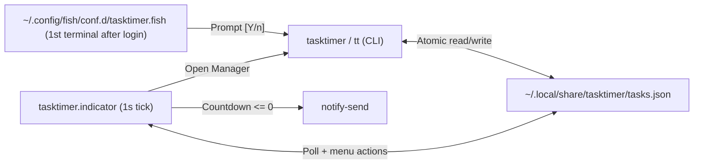

# TaskTimer — Coder Manual

**Author:** `creatico6@github.com`  
**Version:** `0.3.0`  
**Target Environment:** Unprivileged Linux Workstations (Ubuntu 22.04 LTS, GNOME Shell on X11, Fish shell, no `sudo`, no `pip` required)

---

## TL;DR

**TaskTimer** is a zero-dependency, userspace-only task manager and countdown timer built in Python 3.10 + GTK 3:

- **One-time login prompt (`~/.config/fish/conf.d/tasktimer.fish`)**: Uses a session marker in `$XDG_RUNTIME_DIR` (automatically cleared on logout/reboot) to prompt `[Y/n]` only on the first interactive terminal opened after login.
- **Terminal CLI (`tasktimer` / `tt`)**: Interactive menu and direct subcommands (`add`, `list`, `start`, `pause`, `done`, `addtime`, `rm`, `indicator`) backed by atomic JSON persistence (`~/.local/share/tasktimer/tasks.json`).
- **Desktop Top-Bar Widget (`tasktimer/indicator.py`)**: Uses `AyatanaAppIndicator3` when GNOME's AppIndicator extension is active, and automatically falls back to an always-on-top, draggable GTK3 floating pill (`TaskTimerFloatingPill`) on restricted GNOME sessions where `ubuntu-appindicators@ubuntu.com` is not installed.
- **Reproduce in 4 steps**:
  1. Clone/copy the `TaskTimer/` directory into `~/Projects/TaskTimer`.
  2. Symlink `bin/tasktimer` to `~/.local/bin/tasktimer` and `~/.local/bin/tt`.
  3. Copy the Fish startup hook to `~/.config/fish/conf.d/tasktimer.fish`.
  4. Run `python3 -m unittest discover -s tests -v` and launch `tt --startup`.

---

## 1. Prerequisites & Environment Verification

Everything runs in **userspace** with no root privileges (`sudo`) and no `pip` packages. Verify the host provides:

| Dependency | Purpose | Verification Command |
| :--- | :--- | :--- |
| Python `3.10+` | Core runtime & stdlib (`json`, `tempfile`, `argparse`, `unittest`) | `python3 --version` |
| `python3-gi` (`Gtk 3.0`, `Gdk 3.0`, `GLib`) | Floating GTK3 top-bar pill & dropdown menu | `python3 -c "import gi; gi.require_version('Gtk', '3.0'); gi.require_version('Gdk', '3.0'); from gi.repository import Gtk, Gdk, GLib"` |
| `AyatanaAppIndicator3 0.1` *(optional)* | Native GNOME tray indicator when extension is enabled | `gnome-extensions list --enabled` |
| `notify-send` *(optional)* | Desktop notification when countdown reaches `00:00` | `which notify-send` |
| `fish` | Interactive shell startup hook | `which fish` |
| `gnome-terminal` or `x-terminal-emulator` | Launching the terminal manager from the GUI menu | `which gnome-terminal x-terminal-emulator` |

---

## 2. Project Layout

```text
TaskTimer/
├── bin/
│   └── tasktimer              # Executable entry point (symlinked to ~/.local/bin/tasktimer & tt)
├── tasktimer/
│   ├── __init__.py            # Package metadata & version
│   ├── storage.py             # Atomic JSON storage, duration parser, countdown/overtime math
│   ├── indicator.py           # PID-locked daemon: AppIndicator3 or GTK3 Floating Pill fallback
│   └── cli.py                 # Interactive terminal menu & direct subcommands
├── tests/
│   └── test_storage.py        # Unit tests (stdlib unittest)
├── CoderManual.md             # This manual
├── LICENSE                    # MIT License
├── README.md                  # Quick-start user guide
├── TaskTimer.jpg              # Preview image displayed in README.md
├── uninstall.sh               # Interactive userspace uninstaller
└── VersionControl.md          # Changelog & version history
```

Runtime files (created automatically in XDG user directories):
- `~/.local/share/tasktimer/tasks.json` — Active task list and timer state (IDs reset to `1` when empty).
- `~/.local/share/tasktimer/history.jsonl` — Append-only permanent history of completed and removed tasks.
- `$XDG_RUNTIME_DIR/tasktimer-indicator.pid` — Single-instance lock for the GUI daemon.
- `$XDG_RUNTIME_DIR/tasktimer_session_prompted_<UID>` — Per-login-session marker for Fish.
- `~/.config/fish/conf.d/tasktimer.fish` — Fish startup hook (kept separate from `config.fish` so `TiDefinitions.sh` updates never overwrite it).

---

## 3. Architecture & Implementation Details



### 3.1. Data Model & Atomic Storage (`tasktimer/storage.py`)

Each task in `tasks.json` has the following schema:

```json
{
  "id": 1,
  "title": "Study Libft",
  "description": "Review ft_split",
  "allocated_seconds": 2700,
  "elapsed_seconds": 0,
  "status": "pending",
  "started_at": null,
  "notified_overtime": false,
  "created_at": "2026-11-15T09:50:00+00:00",
  "completed_at": null
}
```

Key design choices:
1. **Atomic writes**: `_save_raw()` writes to a temporary file in the same directory via `tempfile.mkstemp()` and swaps it with `os.replace()`. This guarantees the GUI daemon never reads a partially written JSON file while the CLI is saving.
2. **Drift-free timing**: Instead of incrementing a counter every second, `started_at` stores the Unix epoch timestamp when a task starts/resumes. Elapsed time is computed dynamically as `elapsed_seconds + (now - started_at)`.
3. **Single active timer**: `start_task(task_id)` automatically pauses any currently `"running"` task and flushes its accumulated `elapsed_seconds`.
4. **Countdown & Overtime**: `remaining_seconds(task)` returns `allocated_seconds - current_elapsed(task)`. Negative values represent overtime and are formatted with a leading `+` (e.g., `+02:15`).

### 3.2. Top-Bar Indicator & Floating Pill Fallback (`tasktimer/indicator.py`)

On standard Ubuntu Desktop, `ubuntu-appindicators@ubuntu.com` renders `AyatanaAppIndicator3` icons in the top bar. On **restricted GNOME sessions**, that extension may not be installed or enabled, so `AyatanaAppIndicator3` runs silently without displaying anything.

To solve this without `sudo` or restarting GNOME Shell:
- `_has_gnome_appindicator_extension()` runs `gnome-extensions list --enabled` and checks for `appindicators`.
- **If enabled**: uses `TaskTimerAppIndicator` (`AyatanaAppIndicator3.Indicator`).
- **If disabled/missing**: falls back to `TaskTimerFloatingPill`, a borderless `Gtk.Window` configured with:
  - `set_keep_above(True)` and `stick()` (visible on all workspaces, above all windows).
  - `set_accept_focus(False)`, `set_skip_taskbar_hint(True)`, `set_skip_pager_hint(True)`.
  - `Gdk.WindowTypeHint.UTILITY` positioned at the top-right of the primary monitor's `workarea`.
  - CSS styling (dark pill `#1e222a`, switching to `#4c1d24` with `#bf616a` border during overtime).
  - Left-click (without drag) or right-click opens the `Gtk.Menu`; dragging moves the pill anywhere on screen.
- **Anti-flicker menu updates**: `_refresh()` computes a lightweight `signature` of `(id, status, title, allocated_seconds)`. The `Gtk.Menu` is only rebuilt when that signature changes; on regular 1-second ticks, only the top-bar label and the header menu item text are updated.
- **Important PyGObject detail**: Always call `gi.require_version("Gdk", "3.0")` alongside `gi.require_version("Gtk", "3.0")` before importing from `gi.repository`, otherwise PyGObject may auto-load `Gdk 4.0` and raise `gi.RepositoryError`.

### 3.3. Terminal CLI (`tasktimer/cli.py`)

Supports both an interactive numbered menu (`tasktimer` or `tt`) and direct subcommands:
- `tt add "Title" 25m -d "Description" --start`
- `tt list [--active-only]`
- `tt start <id>` / `tt pause` / `tt done [id]`
- `tt addtime <id> 5m` / `tt rm <id>`
- `tt indicator start|stop|status`
- `tt --startup` (starts the background indicator if not running, then enters the interactive menu)

### 3.4. One-Time-Per-Login Fish Hook (`~/.config/fish/conf.d/tasktimer.fish`)

```fish
# TaskTimer: prompt only on the first interactive terminal opened after login
if status is-interactive; and command -sq tasktimer
    set -l _tt_runtime (set -q XDG_RUNTIME_DIR; and echo $XDG_RUNTIME_DIR; or echo /tmp)
    set -l _tt_marker "$_tt_runtime/tasktimer_session_prompted_"(id -u)
    if not test -f "$_tt_marker"
        touch "$_tt_marker"
        echo ""
        read -l -P "⏱  Open TaskTimer and activate the top-bar indicator? [Y/n] " _tt_ans
        if test -z "$_tt_ans"; or string match -qi -r '^[sy]$' -- "$_tt_ans"
            tasktimer --startup
        end
    end
end
```

Why `conf.d/tasktimer.fish`?
- Fish automatically sources every `*.fish` file in `~/.config/fish/conf.d/`.
- It keeps `~/.config/fish/config.fish` untouched, avoiding conflicts with `TiDefinitions.sh`.
- `$XDG_RUNTIME_DIR` (`/run/user/$UID`) is a `tmpfs` managed by `systemd-logind` that is wiped on logout/reboot, so the prompt naturally resets on every new login session.

---

## 4. Reproducing From Scratch

```bash
# 1. Ensure executable permissions and userspace symlinks
chmod +x ~/Projects/TaskTimer/bin/tasktimer
mkdir -p ~/.local/bin ~/.config/fish/conf.d
ln -sf ~/Projects/TaskTimer/bin/tasktimer ~/.local/bin/tasktimer
ln -sf ~/Projects/TaskTimer/bin/tasktimer ~/.local/bin/tt

# 2. Verify Fish syntax and run unit tests
fish -n ~/.config/fish/conf.d/tasktimer.fish
python3 -m unittest discover -s ~/Projects/TaskTimer/tests -v

# 3. Launch TaskTimer and top-bar indicator
tt --startup
```

---

## 5. Troubleshooting

- **Indicator does not appear on screen**: Run `tt indicator status` and `echo $DISPLAY`. Verify `python3 -c "import gi; gi.require_version('Gtk','3.0'); gi.require_version('Gdk','3.0'); from gi.repository import Gtk, Gdk"` exits with code `0`.
- **Prompt does not appear when opening a new terminal**: That is expected once per login session. To test the prompt again, remove the marker: `rm -f $XDG_RUNTIME_DIR/tasktimer_session_prompted_(id -u)`.
- **`tt` command not found**: Ensure `~/.local/bin` is in your Fish `PATH` (`fish_add_path $HOME/.local/bin`).
