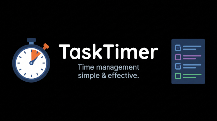

**TaskTimer** by `creatico6@github.com`

A lightweight terminal task manager with a **native GNOME top-bar / floating timer indicator**, built to run **100% in userspace (no `sudo`, no `pip`)** (Ubuntu 22.04 / GNOME + `fish`).

## Features

- **Smart `fish` startup**: On the first interactive terminal opened after login, prompts `[Y/n]` to start TaskTimer and activate the top-bar indicator. Never prompts again in subsequent terminal windows during the same login session.
- **Task Manager**: Create, list, start, pause, extend (`+5m`), and complete tasks with a title, optional description, and allocated duration (`25m`, `1h30m`, `45s`).
- **Top-Bar Indicator**: Displays the active task and live countdown (`▶ Task (24:15)`), with a dropdown menu to pause/resume, switch tasks, add `+5 min`, complete, or open the terminal manager. Automatically falls back to a draggable always-on-top GTK3 pill on GNOME sessions without `ubuntu-appindicators@ubuntu.com`.
- **Overtime Alerts**: Sends a desktop notification (`notify-send`) when allocated time reaches `00:00` and continues tracking overtime (`⚠ Task (+01:10)`).

## Installation (Userspace Only — No `sudo`, No `pip`)

**Requirements:** Python `3.10+` with system GTK3 bindings (`python3-gi` / `Gtk 3.0` + `Gdk 3.0`), plus `notify-send` (optional, for desktop alerts).

1. **Clone the repository and create command symlinks:**
   ```bash
   mkdir -p ~/Projects ~/.local/bin
   git clone https://github.com/CreaTico6/TaskTimer.git ~/Projects/TaskTimer
   chmod +x ~/Projects/TaskTimer/bin/tasktimer
   ln -sf ~/Projects/TaskTimer/bin/tasktimer ~/.local/bin/tasktimer
   ln -sf ~/Projects/TaskTimer/bin/tasktimer ~/.local/bin/tt
   ```

2. **Ensure `~/.local/bin` is in your `PATH`** (in Fish, run once):
   ```fish
   fish_add_path ~/.local/bin
   ```

3. **(Optional) Enable the once-per-login Fish startup prompt:**
   ```fish
   mkdir -p ~/.config/fish/conf.d
   cat <<'EOF' > ~/.config/fish/conf.d/tasktimer.fish
   if status is-interactive; and command -sq tasktimer
       set -l _tt_runtime (set -q XDG_RUNTIME_DIR; and echo $XDG_RUNTIME_DIR; or echo /tmp)
       set -l _tt_marker "$_tt_runtime/tasktimer_session_prompted_"(id -u)
       if not test -f "$_tt_marker"
           touch "$_tt_marker"
           echo ""
           read -l -P "⏱  Open TaskTimer and activate the top-bar indicator? [Y/n] " _tt_ans
           if test -z "$_tt_ans"; or string match -qi -r '^[sy]$' -- "$_tt_ans"
               tasktimer --startup
           end
       end
   end
   EOF
   ```

4. **Data files** (created automatically):
   - `~/.local/share/tasktimer/tasks.json` (active tasks)
   - `~/.local/share/tasktimer/history.jsonl` (permanent history log)

## Usage

### Interactive Mode
```fish
tasktimer
# or
tt
```

### Direct Subcommands
```fish
tt add "Study Libft" 45m -d "Review ft_split" --start
tt list
tt pause
tt start 1
tt addtime 1 10m
tt done 1
tt history            # view permanent history
tt indicator status   # start | stop | status
```

## Documentation, Uninstall & Tests

- See [CoderManual.md](CoderManual.md) for the full technical manual, architecture, and reproduction guide.
- See [VersionControl.md](VersionControl.md) for the changelog and [LICENSE](LICENSE) for the MIT License.
- To uninstall, run `~/Projects/TaskTimer/uninstall.sh`.

```fish
python3 -m unittest discover -s ~/Projects/TaskTimer/tests -v
```
